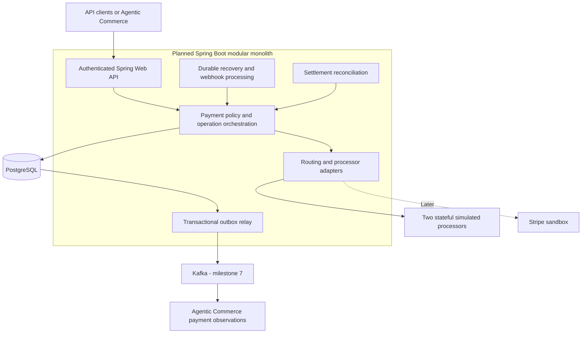

# Distributed Payment Processing Platform — Clean-Room Implementation

A planned Java/Spring Boot platform for transaction routing and payment lifecycles that preserves financial correctness through concurrent requests, processor uncertainty, and recoverable asynchronous work.

**Architecture and implementation planning. Application development has not started.**

## Why I am building it

This project is an independent clean-room implementation developed to refresh and deepen my understanding of payment processing and distributed backend engineering after previous professional experience in the payments domain. Using public references, general domain knowledge, and original design decisions, I will implement transaction routing, payment lifecycles, concurrency controls, and reliability mechanisms with Java and Spring Boot.

It does not reproduce a former employer's proprietary code, architecture, schemas, endpoints, or internal documents. [Juspay Hyperswitch](https://github.com/juspay/hyperswitch) is a public engineering reference, not a codebase being translated into Java. Production-oriented engineering is the goal; no production use, deployment, or performance is claimed.

## Problem and planned capabilities

A processor can authorize a payment and lose its response. Two callers can attempt to capture the same authorization, and two refunds can race against one remaining balance. A successful database commit can be followed by a failed event publication. These situations require explicit identities, transaction boundaries, state machines, and recovery—not a generic retry around every request.

The proposed platform will support authorization, capture, void/cancellation, applicable reversal, refund, inquiry, two stateful simulated processor adapters, safe routing, durable synchronization jobs, webhooks, outbox/Kafka integration, and deterministic settlement reconciliation. It owns authoritative payment state; AI never decides financial correctness.

## Proposed architecture

All components below are planned. Start with one modular monolith and one authoritative PostgreSQL database; background workers can later share the application artifact.

See [architecture](docs/architecture.md), [domain model](docs/domain-model.md), and [processor design](docs/processor-integrations.md).

## Planned stack

| Layer | Baseline and adoption |
| --- | --- |
| Runtime/API | Java 21, Maven, Spring Boot, Spring Web |
| Data | PostgreSQL, Spring Data JPA/Hibernate, Flyway; explicit SQL for coordination where clearer |
| Reliability | Durable operation state first; Resilience4j for bounded provider isolation and classified retries |
| Events | Transactional outbox, Apache Kafka, idempotent consumers at milestone 7 |
| Testing | Requested JUnit 5 baseline, Mockito, Testcontainers; Boot/JUnit support compatibility is an explicit pre-implementation decision |
| Performance | k6 against simulated processors; 100/500/1,000 requests per second are exploratory targets, not results |
| Visibility | OpenTelemetry, Micrometer, Prometheus, Grafana |
| Environments | Docker Compose locally; GitHub Actions and AWS ECS/RDS only in later approved milestones |

Redis, microservices, Kubernetes, and a workflow engine are not initial requirements. Spring Boot 3.5's OSS support has ended, while current Boot 4.x manages JUnit 6. The plan preserves the requested JUnit 5 requirement and makes the supported-version choice an explicit milestone-1 gate rather than silently choosing an unsupported runtime or changing test generations. [Technology decision](docs/adr/006-runtime-and-infrastructure.md).

## Engineering depth and design decisions

The [twelve mandatory production scenarios](docs/production-scenarios.md) drive development: duplicate authorization, lost processor response, outage/fallback, concurrent capture/refund, rate limiting, duplicate/reordered webhooks, failed publication, Kafka redelivery, recovery-worker crashes, settlement mismatch, and overload.

Proposed decisions: short database transactions; one active financial operation per payment initially; durable command idempotency; uncertainty retained until source evidence resolves it; no cross-processor fallback after ambiguous dispatch; outbox and at-least-once delivery; reconciliation independent of payment execution. [ADRs](docs/adr/001-modular-monolith.md) record alternatives and consequences.

## Roadmap and validation

| Milestones | Planned result |
| --- | --- |
| 0 | Research, architecture, documentation; current scope only |
| 1–3 | Foundations, authorization state machine, durable idempotency and concurrency |
| 4–6 | Processor adapters/routing, uncertainty/recovery, capture/void/refund/reversal |
| 7–9 | Outbox/Kafka, webhooks/recovery, settlement/reconciliation |
| 10–12 | Measured load/observability, optional sandbox/deployment, commerce contract verification |

All application milestones are unstarted and require approval. The [implementation plan](docs/implementation-plan.md) defines tasks, prerequisites, tests, fault exercises, acceptance criteria, and interview questions. The [learning roadmap](docs/learning-roadmap.md) follows that sequence. No application, build file, migration, test implementation, CI, or deployment configuration exists yet; running instructions will follow verified executable slices.

Planned validation uses real PostgreSQL semantics, deterministic race barriers, independently stateful simulators, crash-window injection, replay tests, and post-load reconciliation of financial effects. Stripe and LLM APIs are excluded from high-volume traffic. No measurements exist. [Testing strategy](docs/testing-strategy.md).

## Commerce integration

[Agentic Commerce](https://github.com/sontiachyut/agentic-commerce-platform) will submit deterministically authorized sandbox payment commands and inquire about authoritative outcomes. Commerce owns user intent, purchasing permission, stock, orders, and dispensing; this platform owns payment operations. Both run independently through simulated adapters. [Shared contract and recovery sequences](docs/commerce-integration.md).

## Technical documentation

- [Requirements and scope](docs/requirements.md)
- [Hyperswitch source and test analysis](docs/reference-analysis.md)
- [Architecture](docs/architecture.md), [domain model](docs/domain-model.md), [API contracts](docs/api-contracts.md)
- [Processor integrations and retry classification](docs/processor-integrations.md)
- [PS-01 through PS-12](docs/production-scenarios.md)
- [Implementation plan](docs/implementation-plan.md), [learning roadmap](docs/learning-roadmap.md), [testing](docs/testing-strategy.md)
- [Cross-project system](docs/commerce-integration.md), [risks and decisions](docs/risks-and-constraints.md)
- [Future milestone workflow](AGENTS.md)
