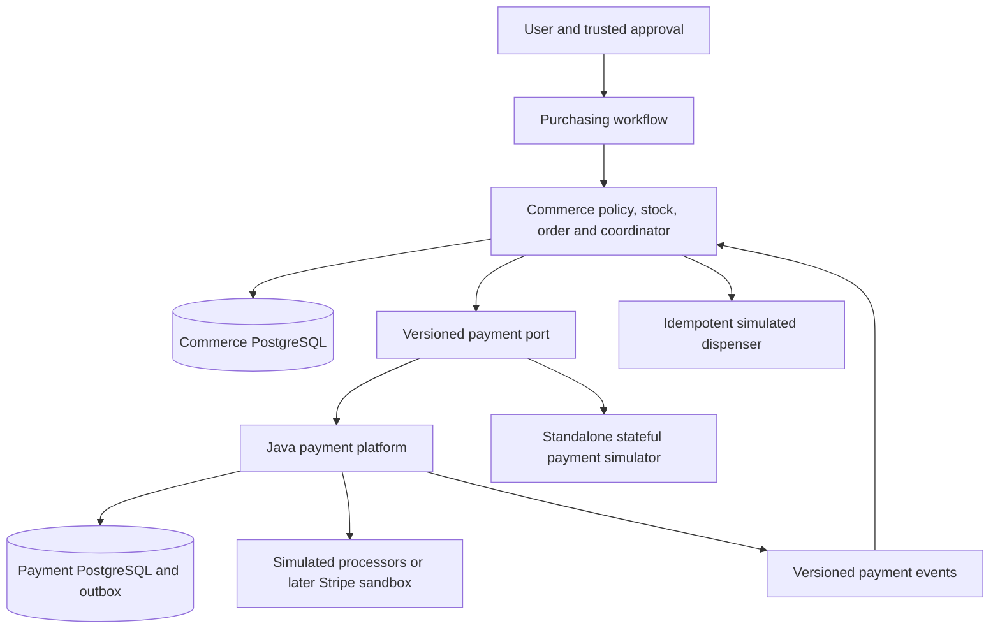
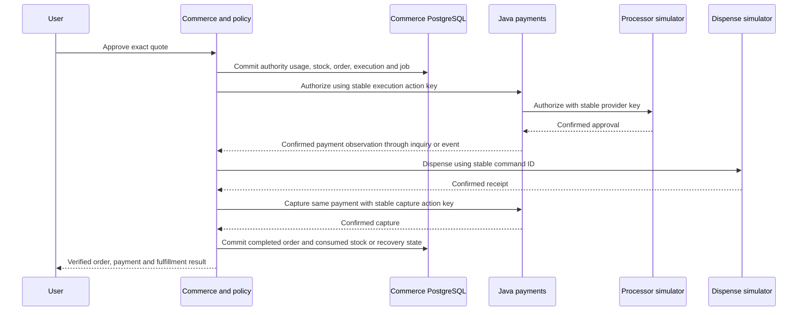
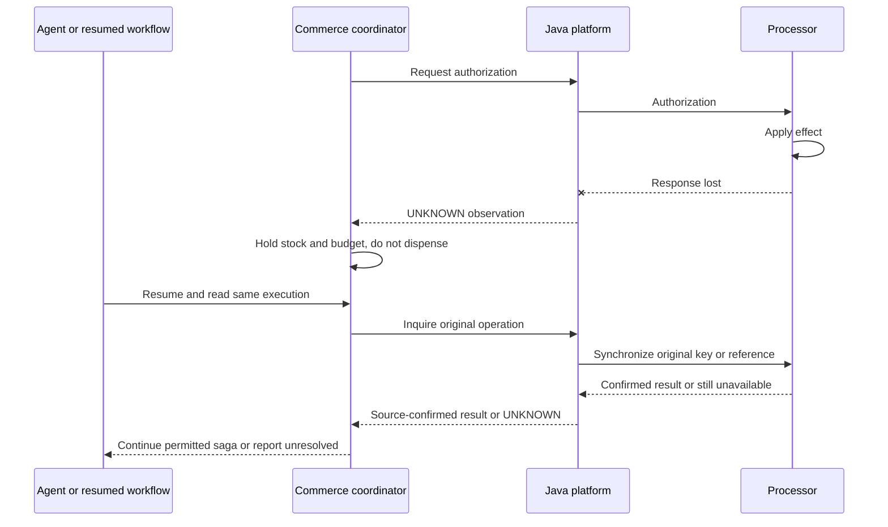
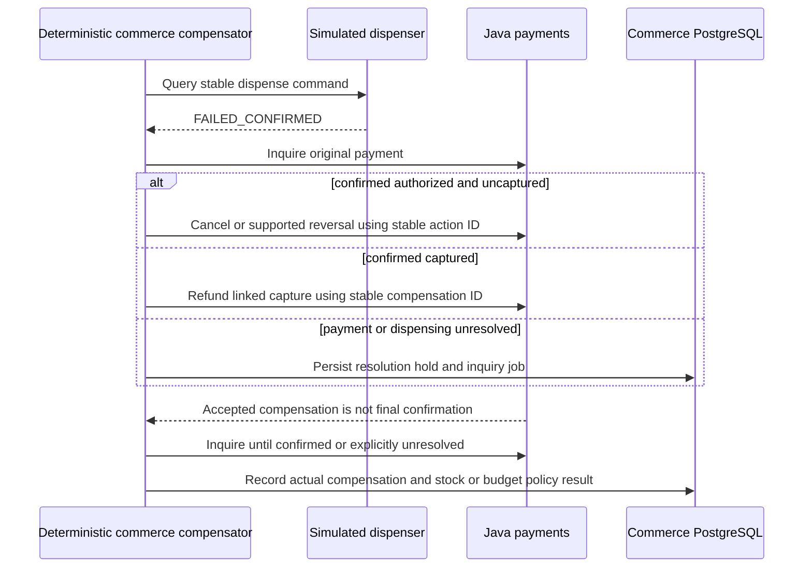

# Proposed cross-project contract — commerce-payment-v1

**Status:** milestone-0 design only; no API schema implementation, adapter, fixture or integration test exists. **Baseline:** 2026-10-21. Identical proposal is maintained in both repositories; changes require coordinated review, then later versioned executable contracts.

Repositories: [Java payment platform](https://github.com/sontiachyut/payment-processing-cleanroom-implementation) and [Agentic Commerce](https://github.com/sontiachyut/agentic-commerce-platform).

## Ownership and independent execution

Commerce owns user intent, human/delegated purchase authority, quote, stock reservation, order, execution and simulated dispensing. Java owns logical payment, financial operations, processor attempts/routing, authoritative financial facts and reconciliation. Agent graph owns interpretation/planning state, never either system's transactional truth. No shared DB, credentials, migration or distributed SQL transaction.

Java can run API/simulator scenarios with commerce stopped. Commerce can use a thin stateful simulated payment port with Java/Kafka/Stripe stopped. Simulator implements the payment contract, not Java routing/ledger/reconciliation. The agent can be faked for mechanics tests or separately evaluated with an approved model.

## Identity and binding contract

| Field | Meaning and validation |
| --- | --- |
| purchase_session_id / agent_run_id | Interpretation workflow context; not command dedup identity |
| user_id / agent_id | Trusted opaque subject identifiers, not model-provided identity or raw PII |
| merchant_id / kiosk_id | Canonical payee/retail source, authorized by commerce and Java client scope |
| product_id / order_line_id | Immutable item/quantity snapshot in commerce; Java receives minimal binding refs/digest, not catalog authority |
| order_id / checkout_id / execution_id | Stable business purchase and one accepted execution; retries resolve same execution |
| authorization_id / authority_version | Exact human approval or delegated-grant execution binding; distinct from financial authorization hold |
| quote_id / quote_version / quote_hash | Authoritative all-in total/currency/item/quantity/merchant/expiry binding; price edits require new quote |
| payment_id / operation_id | Java-assigned authoritative resources returned on accepted financial commands |
| processor_attempt_id | Transport attempt observation, separate from operation; sanitized diagnostic reference only |
| financial_action_id / idempotency_key | Stable per execution/kind/business action across retries; repeated command with changed semantics conflicts |
| correlation_id / causation_id / event_id | Workflow tracing, causal link, immutable delivery dedup identity respectively |
| payment_status / order_status / fulfillment_status | Separate source-owned observations; never collapsed to one success Boolean |
| occurred_at / recorded_at / observed_at | UTC source/business/record/retrieval timestamps; not sole ordering or dedup criterion |
| failure_class / source_version | Known decline, policy denial, capacity, uncertain dispatch, unavailable evidence, fulfillment failure etc., with authoritative version |

Commerce may send a minimal trusted signed service attestation or persisted-authority digest/reference under authenticated client context: execution/order/authority version, quote hash, amount/currency, merchant, subject refs and issuance/audience/expiry. Java validates service trust, scope, binding consistency and payment policy; it does not query commerce DB or delegate financial validation to an LLM. This is a project contract, not AP2 cryptographic compatibility. A compromised commerce authority service is an explicit trust-boundary risk; signatures cannot make a malicious trusted issuer honest.

## Payment port and API mapping

| Port responsibility | Proposed Java route | Semantics |
| --- | --- | --- |
| Request authorization | POST /api/v1/payments | Frozen amount_minor/currency, business_reference tied to execution, synthetic payment method, merchant and binding; Idempotency-Key required |
| Request capture | POST /api/v1/payments/{id}/captures | Original authorization chain; exact permitted amount and action ID; not a new purchase |
| Request cancellation | POST /api/v1/payments/{id}/cancellations | Only applicable uncaptured state and provider capability; durable linked action |
| Request reversal | POST /api/v1/payments/{id}/reversals | Explicit provider protocol where supported; never generic substitute for captured refund |
| Request refund | POST /api/v1/payments/{id}/refunds | Original capture, amount/currency/reason/action; Java enforces balance including unknown reservations |
| Inquire payment | GET /api/v1/payments/{id} | Confirmed state/totals, active operation, version, last event sequence and timestamps |
| Inquire operation | GET /api/v1/operations/{id} | Accepted/dispatch/unknown/final result, safe failure class and recovery status |
| Read bounded history | GET /api/v1/payments/{id}/history | Attempt/observation refs and source versions, no payment secrets |

Financial POST returns 202 after durable acceptance, never proof of completed authorization/capture/refund. Same scoped key/hash replays original operation; changed input conflicts. Exact versioned error mapping is part of later executable OpenAPI/contract fixtures. Not-found, timeout, known rejection and unavailable must remain distinguishable.

Keys derive deterministically from durable execution, operation kind and immutable business action identity, not graph invocation, HTTP request UUID or model-generated text. Keep original keys through crash/unknown inquiry. A second legitimate partial refund has a new business action ID, but a retry of that refund retains it. Duplicate descriptions/amounts alone cannot deduplicate purchases.

## Event contract and read fallback

Proposed envelope v1: event_id, producer/source, envelope_version, event_type, payload_version, merchant_id, payment_id, operation_id, aggregate_version, event_sequence, optional business binding refs, occurred_at, recorded_at, correlation/causation and validated trace context, plus bounded typed data. No card tokens, secrets, raw payloads or full user prompts.

Facts include operation.accepted/unknown/failed/resolved, authorization.confirmed/declined, capture.confirmed, cancellation.confirmed, refund.confirmed, and reconciliation.exception.detected/updated. Payment events are facts, not permission for a model-selected financial action. Kafka topics are `payments.events.v1` / `payments.exceptions.v1`, keyed merchant/payment; commerce consumes only what it needs. Java commits outbox intent with authoritative state, publishes at least once.

Commerce inbox unique `(source, merchant, event_id)` plus local observation/effect/job intent commits before broker offset. Reused event ID/different digest quarantines. Operation-effect dedup is separate from event delivery dedup. Multiple events can share aggregate version and have distinct sequence. Source `last_event_sequence` helps identify incomplete history across topics; a filtered topic subsequence need not be gap free.

Out-of-order/stale facts are preserved without regressing current observations; contradictory/gapped facts trigger bounded authoritative inquiry. Event delivery can be late or unavailable, so execution uses polling/inquiry fallback and never completes from missing events. No global timestamp order or Kafka↔database exactly-once guarantee is claimed.

Version envelope/payload/API separately. Additive optional fields require compatibility checks; identity, money units, required fields, enum meaning or binding changes normally require a major version. Unknown major/enum has explicit unsupported/quarantine handling, never default success. Future shared synthetic fixtures and executable schemas should have one canonical released version tested by both repositories; documentation mirrors are not conformance tests.

## End-to-end acceptance and recovery

Stock and budget reservation precede payment in our default flow. This avoids knowingly authorizing an unavailable item. No approval implies physical availability until acceptance commits; unknown in-flight effects prevent blind reservation expiry.

Unknown dispense never enters FAILED_CONFIRMED branch. It queries the same command and holds stock, without repeat dispense/refund. Dispensed-but-capture-failed is a distinct financial recovery state; no second item is delivered. Cancellation/refund can themselves remain unknown. All actions are linked original operations under deterministic authority; model has no raw financial tool.

## Cross-project production test matrix

| Payment scenario | Commerce case and shared assertion |
| --- | --- |
| PS-01 duplicate authorization | AC-05 repeated checkout → one order, usage and financial identity |
| PS-02 lost processor response | AC-08/05 → resume same execution, no dispense before required confirmed authority |
| PS-03 outage/fallback | AC-01/08 → safe new-route selection or explicit pending/failure, never uncertain cross-provider retry |
| PS-04 concurrent capture | AC-07/08 → repeated fulfillment callback cannot overcapture or dispense again |
| PS-05 concurrent refund | AC-07 → one bounded original-capture compensation effect per action |
| PS-06 rate limit | AC-08 → bounded retry/backpressure, authority/stock holds and truthful wait |
| PS-07 webhook reorder/duplicate | AC-05/08 → current observations never regress and effects do not repeat |
| PS-08 publication gap | AC-08 → outbox catches up, inquiry fallback continues safe monitoring |
| PS-09 Kafka redelivery | AC-05/08 → inbox and saga action dedup survive consumer crash |
| PS-10 worker crash | AC-08/07 → accepted financial/compensation actions recovered without new identities |
| PS-11 reconciliation | AC-07/order operations → settlement discrepancy remains separate from dispense/capture truth; no autonomous refund |
| PS-12 concurrency/load | AC-04/05 plus deterministic load → stock/budget/payment invariants under synthetic offered load |

Shared future fixtures cover identity/hash mismatch, policy denial, accepted/unknown/final states, duplicate/reordered facts, unknown schemas, stale versions, provider/dispense response loss, late compensation and replay. Source/event and hidden oracle files remain separate. No live funds or external API load.

## Security, development dependencies and demonstration

Commerce coordinator client is scoped to its merchant and approved operation families; agent identity cannot directly authenticate as it. Independent Java tests use synthetic client authorization; they do not depend on commerce availability. No graph/LLM credentials or private permission keys enter Java events. Observe TLS, trusted issuer/audience, least-privilege scopes and safe logs in any future shared environment. Compatibility with AP2/UCP/ACP/TAP requires optional separately validated adapters.

Recommended build order: Java M1–M3 and commerce M1–M2 foundations; Java M4–M6 and commerce M3–M6 independently through simulators; prove complete human-approved purchase before commerce M7 delegated authority. Then Java M7–M9 and commerce M8 recovery; integrate commerce M9 when Java financial API/observations pass contract tests. Java M12 verifies the integration contract designed here. Java M10 and commerce M10 load/evaluation follow correctness, not cloud deployment. Optional sandbox/deployment/protocol work requires separate approval.

Three demonstrations: standalone Java PS corpus, standalone commerce AC corpus through thin simulator, integrated approved purchase plus lost-response and dispense-compensation drills. Turn the other repository off to prove independent operation. Use deterministic load simulator for throughput; LLM agent for realistic business/authorization/evaluation. Publish only actual measured results with limitations after tests run.
