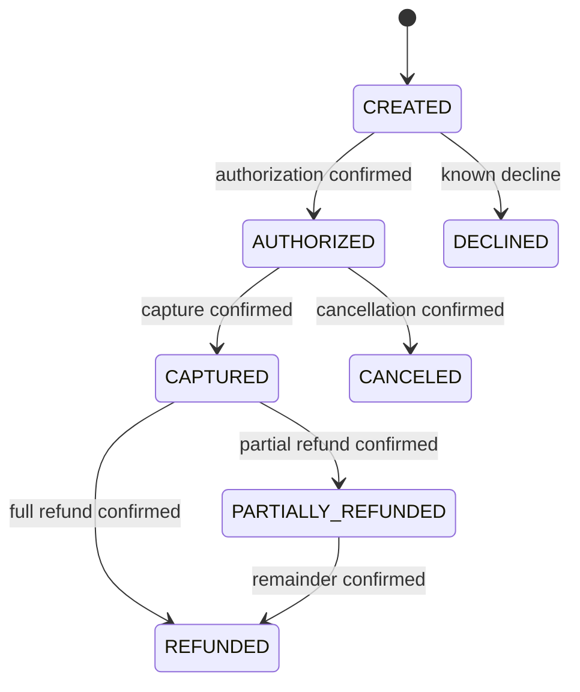

# Proposed payment domain and persistence model

This is an original simplified card-style model. No entities or migrations exist. Authorization is a hold/approval, capture is a later financial operation, settlement is later independent evidence, and a transaction store is not a double-entry ledger.

## Distinct identities and states

Logical payment, accepted operation and provider transport attempt have separate stable identities. A transport retry keeps the operation/provider key but gets a new attempt record. A provider retry does not mean a new user purchase.

Confirmed payment states: CREATED, AUTHORIZED, CAPTURED, PARTIALLY_REFUNDED, REFUNDED, CANCELED, DECLINED. Failed capture/refund operations do not erase prior confirmed payment facts. Pending/unknown work is represented separately.

Operation kinds AUTHORIZE/CAPTURE/CANCEL/REFUND/REVERSE use execution states ACCEPTED, DISPATCHING, UNKNOWN, SUCCEEDED, FAILED. Inquiry is recovery/read work, not another financial reservation. DISPATCHING→UNKNOWN covers uncertain timeout or expired worker; UNKNOWN→SUCCEEDED/FAILED requires authoritative evidence. Retry exhaustion is not proof of non-execution.

## Financial invariants

Use validated signed 64-bit integer minor units; positive command amounts, explicit currency/exponent (USD exponent 2 initially), overflow guards, no floating point or cross-currency arithmetic.

- Confirmed capture plus capture reservations ≤ confirmed authorization.
- Confirmed refunds plus refund reservations ≤ confirmed captures.
- One active financial operation per payment initially, enforced in DB as well as policy.
- Unknown work retains its reservations and blocks conflicting financial commands.
- A canceled authorization cannot be captured; a captured payment is refunded rather than authorization-voided.
- Confirmed operation effects apply locally once, regardless of duplicate response/webhook/inquiry.
- Provider key/processor choice persist before dispatch; follow-up operations remain at the original processor.
- A settlement discrepancy never automatically undoes a financial fact or triggers an LLM-selected financial action.

Example: capture 10,000 minor units, confirmed refunds 6,000, pending refund reservation 3,000. Only 1,000 remains available. A second refund of 3,000 must fail even if the first provider call times out. Confirmed failure releases that operation's reservation; unknown does not.

## Proposed records and constraints

All business rows carry merchant/tenant identity, UTC observation/record timestamps and explicit foreign-key scope. Table names are proposals, not SQL.

| Record | Main fields | Correctness/storage policy |
| --- | --- | --- |
| payment | id, merchant_id, business_reference, currency, requested/authorized/captured/refunded amounts, capture/refund reservations, confirmed_state, version, last_event_sequence | Unique merchant/business_reference; nonnegative/bounded money checks; merchant/date/id search index |
| payment_operation | id, payment_id, kind, amount, execution_state, provider_id/key, active_guard, dispatch marker, lease/fence, next_action_at, normalized_result | Unique active financial operation per payment and provider key; due-work partial index |
| idempotency_record | merchant_id, command_scope, key_hash, canonical_request_hash, operation_id, original_acceptance_response | Unique scoped key; same key/changed semantics conflict; keep tombstone/business guard if later purged |
| processor_attempt | id, operation_id, attempt_number, dispatch/end times, normalized outcome, provider_reference, sanitized response digest | Unique operation/attempt; append observations, never overwrite uncertainty history |
| payment_observation | id, operation_id, source, source_event_id, provider_version, observed_at, result, digest | Preserve late/contradictory observations; do not order provider truth by arrival time alone |
| payment_audit | id, payment_id, operation_id, transition sequence, old/new fact, actor, cause, source | Append-only logical audit; each effect/transition identified |
| outbox | event_id, payment_id, aggregate_version, event_sequence, type/version, minimal payload, due/published/lease fields | Atomic with fact; stable event ID across relay retries; unique payment/event_sequence |
| webhook_inbox / consumer_inbox | source/account, event_id, payload_digest, schema, received/processed state | Unique source/account/event; conflicting reused ID quarantined |
| recovery_job | id, operation_id, kind, generation, due_at, state, owner/fence | Unique logical work/generation; eligible scan and explicit retry ceiling |
| settlement_batch | id, provider, source_batch_id/revision, digest, format, business date/timezone/window, completeness, parser version | Stable identity and revision; bounded staged ingestion; closed window required for absence checks |
| settlement_row | id, batch_id, source_row_id, provider_reference, operation_kind, gross/fee/net minor units, currency | Unique source row; preserve original row/sign normalization provenance |
| reconciliation_result / exception | operation/row/run identities, matcher version, category, occurrence key, expected/observed values, source window, status | Idempotent rerun, superseding corrections, no guessed semantic match |

## Transaction and locking policy

Short payment-row lock serializes reservation/finalization under Read Committed. Consistent lock order is payment→operation→job. Unique DB guards defend against omitted app checks; optimistic versions reject stale observations and administrative edits. A deadlock/serialization failure retries the whole local decision with a bound; it never blindly repeats external IO.

Concurrent idempotency inserts choose one committed winner. A uniqueness error aborts its transaction; winner lookup must occur in a fresh transaction, not by continuing an aborted one. Store semantic hash after validation; raw JSON order is irrelevant. Original 202 replay refers to current operation inquiry instead of returning a misleading reconstructed final result.

Workers claim with skip-locked short transactions and fencing. Expired dispatched work is inquiry-first UNKNOWN. An old worker's late response is preserved as observation but cannot finalize under a stale fence. Provider idempotency/inquiry is required to reason about remote effects; local fencing alone cannot stop a request already at a provider.

## Settlement normalization

The synthetic format uses positive gross magnitude plus CAPTURE direction +1 or REFUND direction -1. Signed fee is positive expense/negative credit; net = direction × gross − fee. Compare operation gross to settlement gross in the same currency, then validate fee/net separately. Preserve provider-native fields for future adapters. Payout grouping, bank balances and general ledger postings are outside MVP.

Detect missing only after operation eligibility, complete import window, processor business-calendar/timezone policy and grace period. Partial imports, unknown capture outcomes and ambiguous references yield incomplete/ambiguous evidence, not false missing/failure conclusions.
